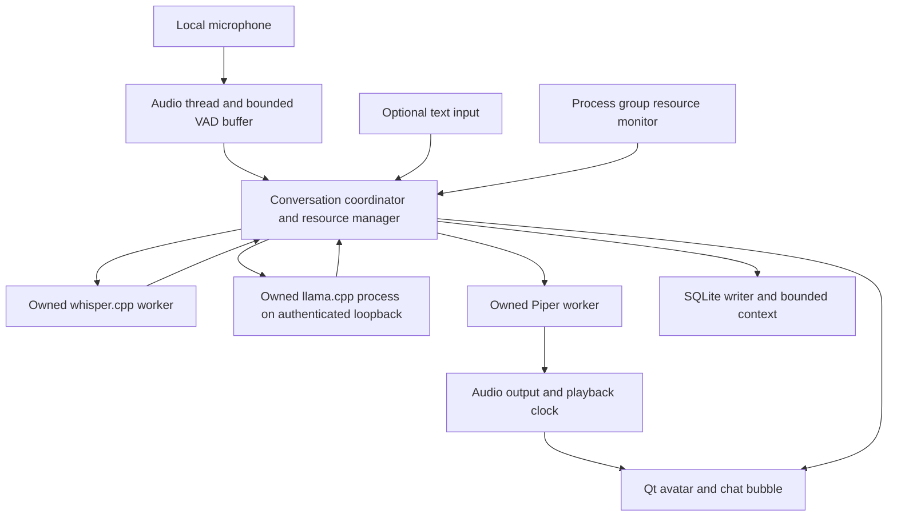

# Offline companion architecture

## Phase 4 implementation status

The user accepted Phase 3 implementation/automated tests and authorized Phase 4, subject to remaining manual visuals. The animated Qt overlay has consent-gated sounddevice capture, WebRTC segmentation, an owned whisper.cpp worker, cancellation and a microphone/transcription panel. Native packages/model are installed; synthetic-PCM native checks and actual Tiny inference/resource measurement pass. Physical capture fails under the agent account, and real speech-quality acceptance remains pending. No LLM, TTS, network runtime or SQLite history exists. See [Phase 4 results](phase-4-report.md) and [audio lifecycle/validation](phase-4-audio.md). The remaining sections retain the approved full-system design, not a claim of completed physical audio acceptance.

## Decision and scope

Use CPython 3.12 x64 with PySide6 Essentials native Widgets and QPainter. Render an original layered 2D anime character. Capture/play audio through sounddevice, detect speech with WebRTC VAD, transcribe through whisper.cpp using pywhispercpp in a supervised Python worker, generate English responses with an owned llama.cpp server, synthesize with a supervised Piper worker, and persist text in SQLite.

This is a proposed architecture, not an implemented or benchmarked application. The three profiles share provider contracts and user controls. Profile A trades latency and conversation depth for memory; B improves language quality; C adds optional GPU offload. See the [comparison](technology-comparison.md) and [budget](memory-budget.md) for selection evidence and estimates.

## Process and event boundaries

The Qt main thread owns windows and animation. A coordinator thread owns the conversation state machine, asynchronous network client, and worker control. Audio callbacks only copy bounded PCM and update counters; they do not transcribe, access SQLite, log text, or wait on locks held by inference. A single database worker serializes writes. Queued Qt signals transfer immutable small UI events.

Workers are created lazily, with no console windows, and assigned to a Windows Job Object before work starts. The owner tracks process handles and creation times; no global process-name kills. Kill-on-job-close handles abnormal parent termination. Windows documents grouped lifecycle and resource control through [Job Objects](https://learn.microsoft.com/en-us/windows/win32/procthread/job-objects).

Profile A runs one heavy stage at a time: ASR completes and its process exits; LLM generates a bounded complete response and exits; Piper then speaks the sentences. Lightweight UI, VAD, and audio remain available. B/C may retain/reuse LLM and Piper and overlap sentence synthesis after their combined peak is measured. The ASR/Piper command loop is reusable within its residency interval; recycling is the reliable fallback when native allocations do not return after unload. Reusing workers never exempts them from accounting.

Use the binding's in-memory NumPy PCM input and an explicit existing model path; never a model name that triggers automatic downloads. Piper's documented streaming API yields PCM chunks. The application will implement bounded inherited-pipe framing for both workers; this is application code still to be written, not a claimed upstream worker protocol. [pywhispercpp implementation](https://raw.githubusercontent.com/absadiki/pywhispercpp/main/pywhispercpp/model.py), [Piper API](https://github.com/OHF-Voice/piper1-gpl/blob/main/docs/API_PYTHON.md). Keep microphone PCM in RAM, with no temporary WAV files in normal operation.

## Contracts and cancellation

Provider interfaces are application-owned contracts to implement, not claims about existing library APIs:

| Contract | Input and output | Required lifecycle |
| --- | --- | --- |
| Recognizer | Bounded 16 kHz PCM; transcript, language/confidence metadata where available | Load, transcribe, cancel, close |
| Generator | Token-budgeted messages; incremental text and final usage | Start/health, generate, cancel, stop |
| Synthesizer | One bounded English sentence and voice controls; PCM chunks with format | Load, synthesize, cancel, close |
| Renderer | Smoothed pose, expression, gesture, mouth amplitude | Load asset, report capabilities, draw, release |
| Audio output | PCM chunks; consumed sample positions and completion | Open, play, flush, close |

Every event carries a session ID, monotonically increasing turn ID, type, and monotonic timestamp. Cancellation increments the turn generation, clears queued text/audio, flushes playback, closes the mouth immediately, and rejects late callbacks. Closing a streaming request must be verified to stop inference; if it does not stop within a bounded timeout, terminate the owned worker. Engine restart cancels the turn before replacing providers. Limit automatic recovery to one restart per failing operation; repeated failure leaves a visible degraded state with manual retry.

Proposed bounds: one active turn, one pending utterance, a 25-second maximum speech segment, two queued TTS sentences, four seconds of playback PCM, 64 control events, and at most 256 characters or 50 ms between coalesced text updates. Critical cancel/mute/shutdown commands use a separate priority path. Queue overflow resets the affected audio segment and reports an overrun; never quietly process stale speech. Sentence length is capped at 300 characters and split at punctuation or safe word boundaries.

## Desktop and avatar

Use one tightly fitted transparent avatar window and a separate small owned bubble/input window below it. Frameless translucency is supported by Qt; on Windows the translucent widget also needs the frameless flag. The tray uses Qt's native tray integration. [Qt window flags](https://doc.qt.io/qtforpython-6/PySide6/QtCore/Qt.html), [QSystemTrayIcon](https://doc.qt.io/qtforpython-6/PySide6/QtWidgets/QSystemTrayIcon.html).

Drag only the character silhouette or a visible handle. Cache an interaction mask covering supported poses and update it on scale/asset changes, not every frame. First test actual Windows layered-window alpha hit testing; if the Qt window still captures empty pixels, apply an appropriate shaped region. Never assume widget-local mouse transparency passes clicks through to another application. Native layered-window behavior is described in [Windows window features](https://learn.microsoft.com/en-us/windows/win32/winmsg/window-features).

Persist logical coordinates, screen identity, scale, and orientation. Clamp the combined character/bubble footprint to the current monitor work area. Handle negative monitor coordinates, monitor removal, mixed DPI, taskbar changes, and DPI transitions without scaling the artwork twice. Move upward when necessary to keep the bubble beneath the character. Reserve only visible bounds, never a full-screen input window.

Context menu: Open Chat, Microphone ON/OFF, Volume, Character Settings, Performance Profile, Always on Top, Click-Through, Restart AI Engine, Exit. In click-through mode, tray and registered global recovery hotkey remain usable. Refuse that mode if neither recovery mechanism is available. Open Chat restores an interactive text window without requiring a click on the avatar.

The renderer takes normalized parameters, independent of the AI engine. Original assets need torso, head, eyelids, mouth, hair sections, and separately pivoted arms/hands; a static image alone cannot provide the requested gestures. Cache rasterized layers/transforms. Use monotonic delta time, damped springs, easing, and seeded irregular timing for breathing, head movement, gaze, sway, hair follow-through, occasional weight shift, and randomized/double blinks. Clamp excessive delta time after resume. Start with 30 FPS, allow 60 in C, reduce to 20 under pressure, and stop drawing when hidden. Avoid recurring per-frame object construction.

Priority is critical state, active gesture, expression, then idle. Greeting waves an arm, explaining points, playful response adds a small bounce, thinking/confusion tilt the head, agreement nods, disagreement shakes, and listening adjusts gaze/posture. Gesture intent comes from bounded phrase matching, punctuation and conversation state; optional model tags are allowlisted and stripped before speech. Capability checks substitute a tilt/expression when an asset lacks arm rigging and record the limitation. Gesture start is attached to the sentence playback event.

## Microphone and playback policy

First launch shows that voice is processed locally and requires an explicit Enable Microphone action. Store consent and the auto-listen preference separately. Later launches activate capture only when both allow it and the device can open. Windows permission/device failure leaves text input usable and displays actionable instructions. The preference may default to ON, but consent never does.

Capture mono PCM at 16 kHz with 20 ms VAD frames; negotiate a supported native device rate and resample if needed. Use a fixed 300 ms pre-roll, initial 600 ms endpoint silence, minimum voiced duration, energy/noise-floor gate, and adjustable VAD aggressiveness. A DC/high-pass filter can reduce rumble; this is not a promise of advanced noise cancellation. Maximum-duration speech is ended visibly, not grown indefinitely.

ON, OFF, unavailable, and temporarily suppressed are separate visible states. OFF immediately marks the UI as off, aborts and closes capture, clears all PCM and VAD state, and rejects in-flight capture events. ON opens the selected device afresh. Device selection, sensitivity, optional push-to-talk, and mute hotkey use the same state machine.

Initial operation is half duplex. While processing a turn and during playback, incoming microphone frames are discarded, not stored for later recognition. After playback ends or cancellation occurs, flush input, wait an initial 300 ms settling interval, reset VAD, and resume only if consent/preference still permit it. A user mute during playback always wins over automatic resumption. No claim of barge-in or echo cancellation is made.

Piper emits bounded PCM chunks at the selected voice's native rate. Resample only when the output device requires it. Control volume in PCM; use supported synthesis settings for voice rate. Compute RMS/envelope from the actual outgoing samples after volume adjustment and align mouth state to the output DAC/sample clock. Silence closes the mouth; underrun and cancellation clear queued envelopes. TTS failure preserves the text response and offers replay after device recovery.

## Language and memory

Use multilingual Whisper, never an English-only `.en` model for the main path. Default to transcription, not translation. Permit an English/Tagalog language hint without forcing a single language on mixed speech. Very short or uncertain recognition prompts a retry or typed correction rather than inventing an utterance.

Qwen3 is selected for evaluation because its published language coverage includes Tagalog, not because that proves this quantized 0.6B model understands colloquial Filipino. English output, bounded length, configurable name/persona, and no claims of consciousness are policy instructions. Disable thinking through the supported chat template and test that reasoning/system text is not exposed. Language checks on complete sentences are heuristic; avoid unreliable classification of tiny fragments. Evaluate the [language cases](roadmap.md) before advertising comprehension.

The language-coverage evidence is the [Qwen team's announcement](https://qwenlm.github.io/blog/qwen3/). The official 0.6B GGUF listing inspected contains Q8_0, not Q4_K_M. Profile A therefore needs a separately verified Q4_K_M conversion with recorded provenance, or an offline conversion from original high-precision weights during model preparation. Do not requantize Q8_0 as though it were original precision. No model conversion or download occurs in Phase 1.

SQLite schema will separate sessions/messages, user preferences, character preferences, explicit memories, and summaries. Use transactions, bounded queries, schema migrations, WAL with bounded checkpoints, and local app-data storage. Context assembly uses the actual model tokenizer: total prompt plus reserved output stays within the profile context. Keep recent complete turns first; older context is trimmed or summarized by the existing LLM, never a second model. Summaries carry provenance and are untrusted data, not system-level instructions. Durable facts require explicit user remembrance; do not infer and store sensitive facts by default.

Retention defaults to 30 days of text history, configurable to session-only; explicit memories persist until deletion. Provide delete session, forget explicit memory, and reset all memory. Deletion includes summaries, WAL/journal cleanup, temporary audio, and application-created backups; explain that logical deletion is not forensic erasure of SSD storage. Do not persist raw microphone audio by default.

## Configuration, failures, and offline boundaries

Versioned JSON stores profiles, device IDs, consent/preferences, model paths, bounds, character metadata, and window geometry. Validate finite ranges and path existence before startup; an invalid file is preserved for diagnosis and replaced only through an explicit reset flow. Default logs contain component/error codes, timings and resource counts, not prompts, transcripts, speech audio, or local API tokens. Logs rotate with a size cap.

The llama.cpp server binds only to `127.0.0.1`, uses a random per-launch local authentication token, one inference slot, bounded context/output, and local model paths. Disable remote model fetching, proxy/multi-model routing, and web UI where supported by the pinned build. The token is generated internally; the user needs no API key. Its documented authentication options are verified, but exact flags must be checked against the pinned executable's help. [Server documentation](https://github.com/ggml-org/llama.cpp/blob/master/tools/server/README.md).

ASR/Piper use private inherited pipes with length/format limits. Model and asset manifests record source revision, hash, license, and format; reject untrusted code/pickle loading. Runtime never performs online installation. Missing models show installation guidance and retain desktop/text controls; no scripted response is passed off as generated conversation. Corrupt SQLite is preserved and reported, with an explicitly selected temporary session available. Shutdown stops capture, invalidates turns, flushes playback, joins bounded workers, checkpoints storage, and closes the process job.

Future module groups are `app/core`, `desktop`, `avatar`, `audio`, `ai`, `memory`, and `performance`, plus `tests`, `scripts`, and `config`. Create only the modules needed by the authorized phase.
